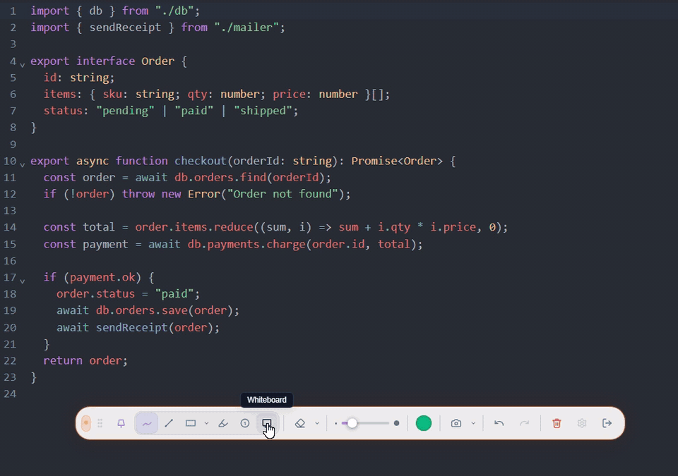

# @openpen/whiteboard

A whiteboard and blackboard backdrop for [OpenPen](https://github.com/openpen-platform/openpen).

Covers the screen with an opaque white, black, or custom-colored backdrop,
drawn beneath your strokes, so you can annotate on a blank board instead of on
top of the screen.

<p align="center">
  
</p>

<p align="center"><sub>Background: CodeMirror 6 with the One Dark theme (https://codemirror.net), MIT License (https://opensource.org/license/mit). The code is fictional.</sub></p>

## Install

Requires OpenPen 1.0.0 or later.

Install from the plugin catalog, then restart OpenPen:

```bash
npx openpen-cli plugin install @openpen/whiteboard
```

To install a build from source instead, build the plugin, then add the
directory to OpenPen and restart it:

```bash
npm install
npm run build
npx openpen-cli plugin add .
```

## Usage

1. Click the **Whiteboard** button in the control bar's tools group to show the
   backdrop. The button is highlighted while the backdrop is on.
2. Draw with any tool. Strokes are drawn on top of the backdrop.
3. Click the button again to remove the backdrop. Strokes already on the
   canvas stay.

The backdrop is off until you turn it on, and the on/off state is saved with
the other settings. Choose the backdrop color in the settings.

## Settings

Open OpenPen's settings and choose the **Whiteboard** panel.

| Setting | Values | Default | Description |
| --- | --- | --- | --- |
| **Mode** | `white`, `black`, `custom` | `white` | `white` is `#ffffff`, `black` is a soft black (`#1e1e1e`), `custom` uses the color below |
| **Custom colour** | any color | `#2e7d32` | Backdrop color used when the mode is `custom`; shown only in that mode |

The on/off state is also stored as a setting (`enabled`, default off). It is
changed with the control bar button rather than in the settings panel.

## License

MIT
